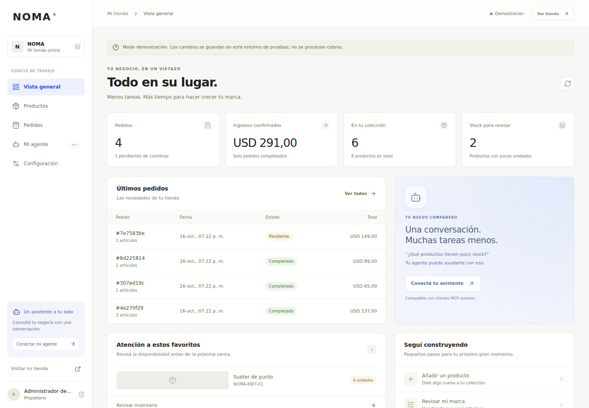
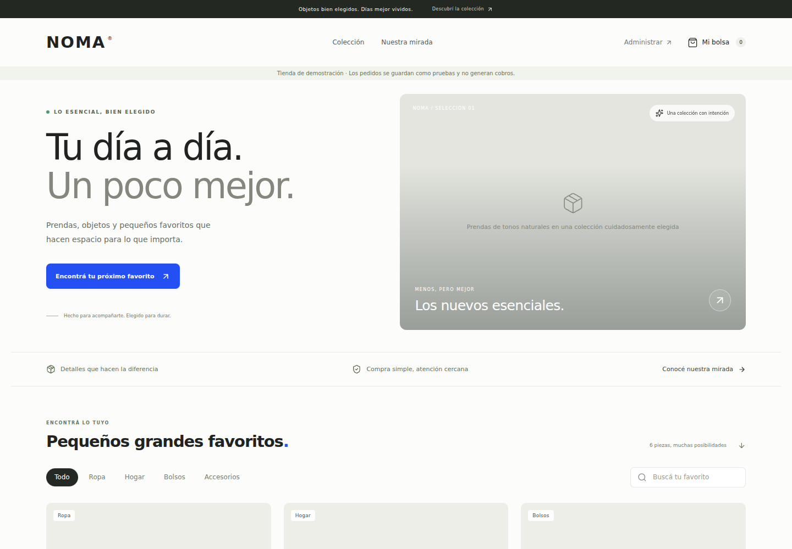
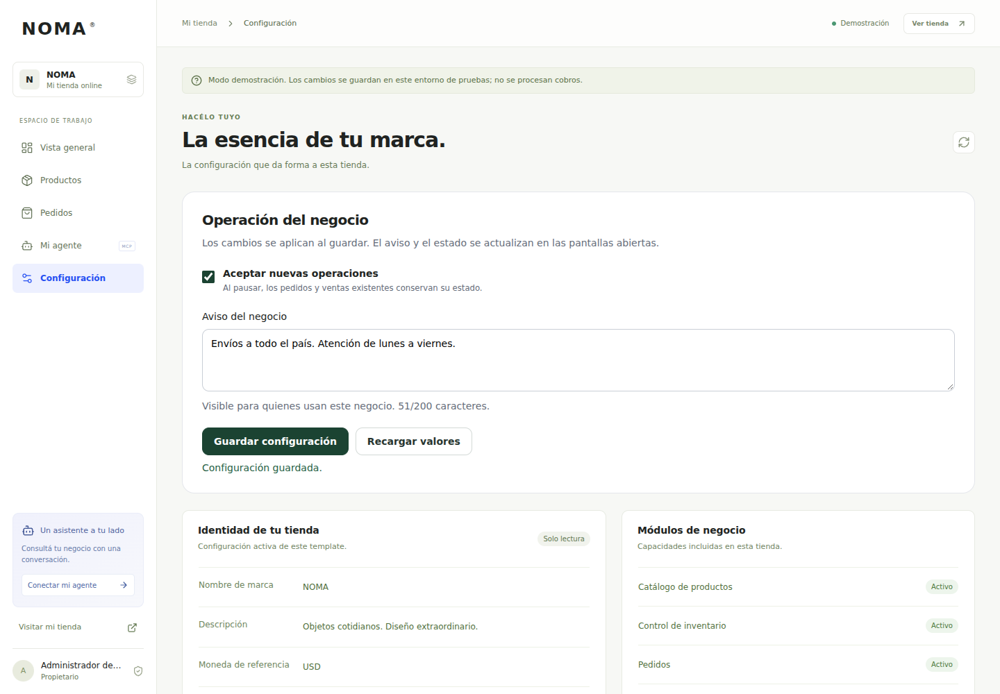
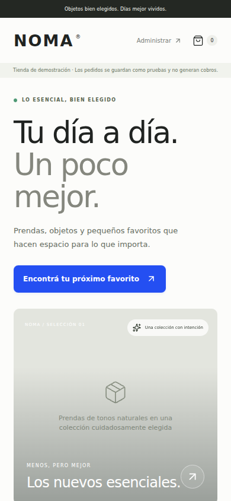

# InzaiQ SaaS Starter

**A modular Next.js foundation for businesses built and operated with agents.**

Start with a working commerce application. Reuse its identity, database, payment, telemetry and MCP boundaries to assemble a client installation or extend a new product.

**English** · [Español](README.es.md) · [Documentation](docs/README.md) · [Latest changes](CHANGELOG.md)

[](https://github.com/JuanCG13/inzaiq-saas-starter/actions/workflows/ci.yml)
[](LICENSE)
[](package.json)
[](package.json)



> A client needs a system → a coding agent assembles the installation → the owner authorizes an assistant to operate it through MCP.

## What you can build on

The current application is a functional **commerce module**: storefront, cart, catalog, inventory, orders and administration. The broader starter provides reusable contracts for additional business models.

| Area | Available today | Extension boundary |
| --- | --- | --- |
| Commerce | Responsive storefront and admin, product editing, stock adjustments, manual checkout and order management | Shipping, tax invoicing, returns and fractional or multi-location inventory |
| Identity | Better Auth organizations, owner/admin/cashier/viewer roles, tenant isolation | Customer-specific account recovery, email delivery and additional identity policies |
| Agent operations | Official MCP SDK, Streamable HTTP, OAuth/PKCE, scopes, consent and revocation | Additional named tools backed by the same domain services |
| Payments | Manual coordination and optional one-time Stripe Checkout, signed webhooks and interrupted-checkout recovery | Other gateway adapters and their redirect policies |
| Live settings | Tenant notice and pause/resume of new orders through UI or MCP | Explicitly authorized operational fields |
| Physical fulfillment | `FulfillmentProvider` and shared context/money contracts | **Contract only:** carrier integration, quotes, dispatch and delivery lifecycle |
| Digital products | `EntitlementProvider` and resource-reference contracts | **Contract only:** verified buyer access, protected storage and downloads |
| Recurring SaaS | `SubscriptionProvider`, entitlement and durable-work contracts | **Contract only:** recurring billing, plans, access policies and workers |

The manifest is a navigation and dependency index for agents. Selecting an extension profile does not install a provider or enable a business workflow. See [business models](docs/business-models.md) and [the extension recipe](docs/extending.md).

## Interface preview

Real application captures from the reference installation, whose UI uses Spanish copy. The NOMA storefront demonstrates the commerce module; branding and customer content are replaceable.

| Storefront | Live operational settings |
| --- | --- |
|  |  |

<details>
<summary>View the mobile storefront</summary>
<br />

</details>

## Run the demo

Requires **Node.js 22+**; CI uses Node.js 24.

```bash
git clone https://github.com/JuanCG13/inzaiq-saas-starter.git
cd inzaiq-saas-starter
npm ci
npm run demo
```

Open [localhost:3000](http://localhost:3000). The script creates an isolated `demo.db` and a git-ignored `.env.local` with a new secret. It preserves existing customer configuration. Demo access is restricted to local development; MCP still requires a real sign-in and OAuth consent.

## Assemble a client installation

Use a fresh checkout without demo configuration:

```bash
npm ci
npm run configure -- --name "Your Business" --currency USD --locale en-US
cp .env.example .env.local
```

Set the database connection, `BETTER_AUTH_SECRET` and canonical `BETTER_AUTH_URL` in `.env.local`, then run:

```bash
npm run db:migrate
npm run auth:migrate
npm run dev
```

Create the owner account at `/sign-in` and the business at `/onboarding`. Set `STORE_TENANT_ID` to that organization's ID, available at `/onboarding/connections`, to select the public store.

| Database | Adapter | Configuration |
| --- | --- | --- |
| Supabase, Neon or PostgreSQL | Kysely + `pg` | Server connection URL and an appropriate connection-pool budget |
| Turso | Kysely + libSQL | Remote libSQL URL and server-side auth token |
| Local SQLite | libSQL file | Development or a deliberately persistent single-server volume |

[Database setup and invariants →](docs/database.md)

Branding and module switches live in [`src/template.config.ts`](src/template.config.ts); agents navigate through [`template.manifest.json`](template.manifest.json) and [`AGENTS.md`](AGENTS.md). The reference UI copy is Spanish. Customize it for the client, replace sample imagery and enter the real catalog. Changing the configured currency does not convert existing prices.

## Let the owner use their own agent

Deploy the application on public HTTPS and add this URL as a custom MCP connection in a compatible client such as ChatGPT or Claude:

```text
https://your-domain/api/mcp
```

The owner signs in, chooses an organization and grants scopes. The assistant calls named operations for products, inventory, orders, reports and settings; the server checks current membership, role and scope. Consent can be revoked at `/onboarding/connections`.

The application needs no OpenAI or Anthropic API key for this workflow. Custom-connector availability depends on the user's client, plan and workspace policy. [MCP setup, tools and authorization →](docs/mcp.md)

## Payments and business integrity

`PAYMENT_PROVIDER=manual` records pending orders for payment coordination. Set `PAYMENT_PROVIDER=stripe` with server-side `STRIPE_SECRET_KEY` and `STRIPE_WEBHOOK_SECRET` to enable the included hosted Checkout adapter. Configure its events at `POST /api/payments/webhooks/stripe` using the [payment guide](docs/payments.md).

Prices and currency are validated on the server. Orders, stock and audit records commit transactionally; persistent idempotency protects retries. Signed, matched provider events update online payment status. A browser return never serves as payment evidence, and uncertain attempts retain their original checkout identity. Card details stay with the provider.

Other gateways use the [`PaymentProvider`](src/payments/contracts.ts) contract plus explicit server registration, client trust rules and tests. [The complete extension map](docs/payments.md#extender-a-otra-pasarela) identifies each required file.

## Designed for agent maintenance

- **One business service across UI, HTTP and MCP.** Tenant, money, permission and inventory rules remain in the domain.
- **Bounded, correlated diagnostics.** Structured JSON logs, request references, optional OpenTelemetry export and transactional business audit; secrets and customer data are excluded from diagnostic payloads.
- **Small, reviewable changes.** Module contracts, additive migrations, meaningful regression tests and a documented agent workflow.
- **Live operational controls.** Change a notice or pause new orders without rebuilding. Existing orders and payment webhooks continue through their lifecycle.
- **Explicit release boundaries.** Code and compiled branding ship as immutable releases with schema-aware readiness and compatible rollback procedures.

Start with [agent workflow](docs/agent-workflow.md), [telemetry](docs/telemetry.md) and [runtime settings](docs/runtime-settings.md).

## Verification

Recorded local evidence: **201 automated tests and 6 browser scenarios passed**, including database transactions, tenant isolation, OAuth/MCP, payment recovery, desktop/mobile flows and live settings. Type checking, the production build and a standalone startup also passed. See [the verification record](docs/verification.md) for scope and reproduction details; the CI badge reports the repository's current workflow status.

```bash
npm run doctor
npm run typecheck
npm test
DEMO_MODE=false npm run build
```

In an isolated demo checkout, run the browser suite:

```bash
npx playwright install chromium
npm run test:e2e
```

`npm run verify` combines types, tests and build. Keep `DEMO_MODE=false` for a production build. Browser tests start their own server and modify the demo database.

Local integration tests use libSQL and PostgreSQL through PGlite. Stripe network responses are simulated while signatures use the official SDK. Live Stripe transactions, hosted database connections and real ChatGPT/Claude account connections require validation for each installation.

## Deployment and growth

The repository includes a standalone [Dockerfile](Dockerfile), [Kubernetes deployment](deploy/kubernetes.yaml), liveness/readiness endpoints, connection-budget checks, an autoscaling overlay and a k6 load scenario. Use the [production runbook](docs/production.md) for migrations, immutable releases, asset compatibility, gradual rollout and rollback; use [scaling](docs/scaling.md) and [enterprise preparation](docs/enterprise.md) to define and measure capacity.

Before accepting real business traffic, validate the chosen database, HTTPS and OAuth, payment sandbox, backups/restoration, traffic controls and deployment recovery. Capacity and uninterrupted upgrades are properties to demonstrate on that infrastructure; this starter does not assign an unmeasured throughput or availability guarantee.

Manual reservations require operational follow-up. Online expiry and failure release stock when verified events arrive; missing events or late payments require reconciliation. Shipping, fiscal invoicing, refunds, protected digital delivery and recurring billing follow the extension contracts above.

## Documentation

| Start here | Operate and extend |
| --- | --- |
| [Installation runbook](docs/assembly.md) | [Production and rollback](docs/production.md) |
| [Architecture](docs/architecture.md) | [Scaling and resource budgets](docs/scaling.md) |
| [Database contracts](docs/database.md) | [Module extension recipe](docs/extending.md) |
| [MCP and OAuth](docs/mcp.md) | [Business-model contracts](docs/business-models.md) |
| [Payments](docs/payments.md) | [Telemetry](docs/telemetry.md) |
| [Verification record](docs/verification.md) | [Agent workflow](docs/agent-workflow.md) |

The READMEs are available in English and Spanish. Technical guides currently use a mix of both languages; the [documentation index](docs/README.md) labels each guide.

## Release and license

**Current release: v0.1.0.** Modular commerce, MCP/OAuth, Stripe Checkout, live operational settings and deployment/extension tooling. [Read the changelog →](CHANGELOG.md)

Released under the [MIT license](LICENSE). Dependencies and sample imagery retain their respective licenses.
