# Galería de pantallas

[English](screens.md) · **Español**

Todas las pantallas de la aplicación de demostración, capturadas de una instalación real en ejecución con el recorrido de navegador de `tests/screenshots/`. Seleccione una miniatura para ver la imagen completa. Cada pie indica la ruta bajo el prefijo de idioma `/en`.

Los datos son la semilla local de demostración (seis productos de ejemplo) más unos pocos registros ficticios que el recorrido crea con la interfaz real: clientes en el dominio reservado `example.invalid`, una cuenta de propietario de ejemplo y un cliente OAuth de ejemplo. Nada es real y no se procesa ningún pago. Las referencias y fechas de los pedidos son las de la ejecución de la captura.

Las imágenes están en inglés. Esta página ofrece los pies de foto en español para las mismas imágenes; la [página en inglés](screens.md) tiene los pies en inglés.

## Tienda

Lo que ve un visitante antes de comprar: la portada, la colección, un producto y la página de error 404.

| | |
| --- | --- |
| <a href="screenshots/en/storefront-hero.webp" title="Imagen completa">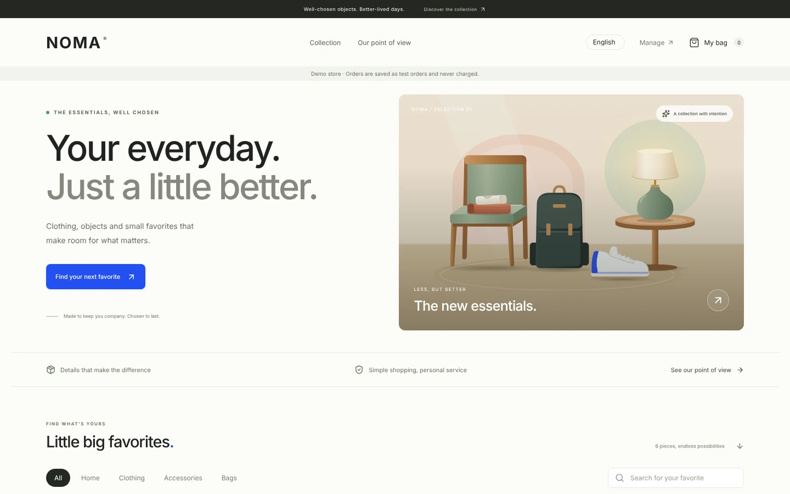</a><br />**Portada**<br />`/en` · Escritorio 1440×900<br />La primera pantalla de la tienda de demostración: barra de anuncio, encabezado con selector de idioma y bolsa, y la portada con su llamada a la acción. | <a href="screenshots/en/storefront-collection.webp" title="Imagen completa">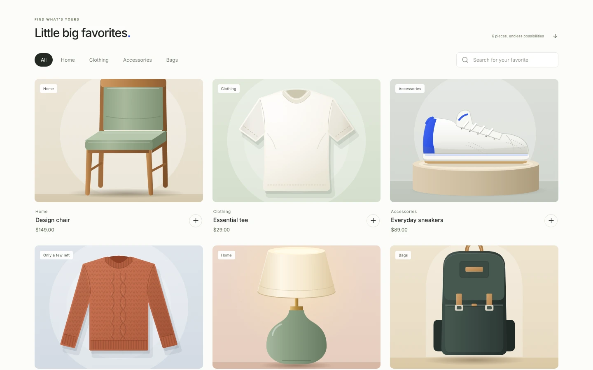</a><br />**Colección**<br />`/en#collection` · Escritorio 1440×900<br />La cuadrícula de productos con filtros por categoría y búsqueda. Los precios usan la moneda predeterminada y las imágenes son el arte SVG propio de public/demo. |
| <a href="screenshots/en/storefront-product.webp" title="Imagen completa">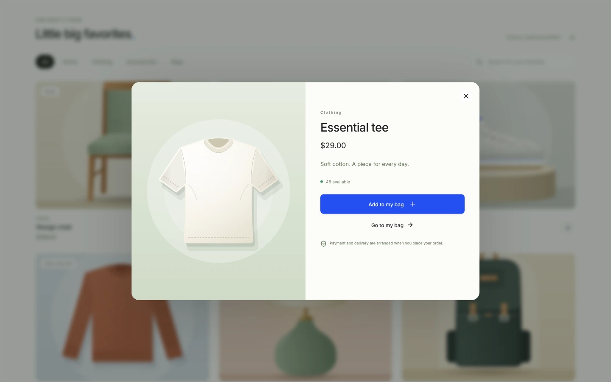</a><br />**Detalle de producto**<br />`/en#collection` · Escritorio 1440×900<br />El diálogo de producto abierto desde la colección, con precio, existencias y la acción para agregar a la bolsa. | <a href="screenshots/en/storefront-mobile.webp" title="Imagen completa">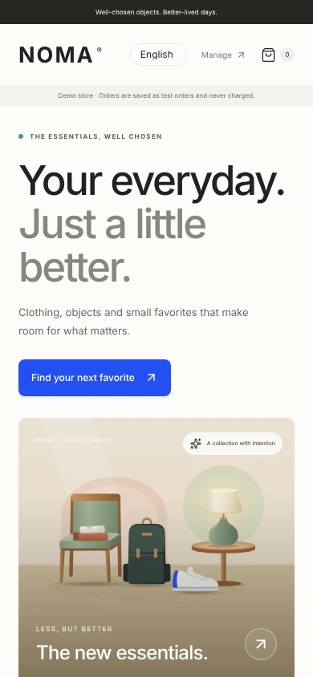</a><br />**Tienda en el teléfono**<br />`/en` · Teléfono 390×844<br />La misma portada con 390 px de ancho; el diseño pasa a una sola columna. |
| <a href="screenshots/en/not-found.webp" title="Imagen completa">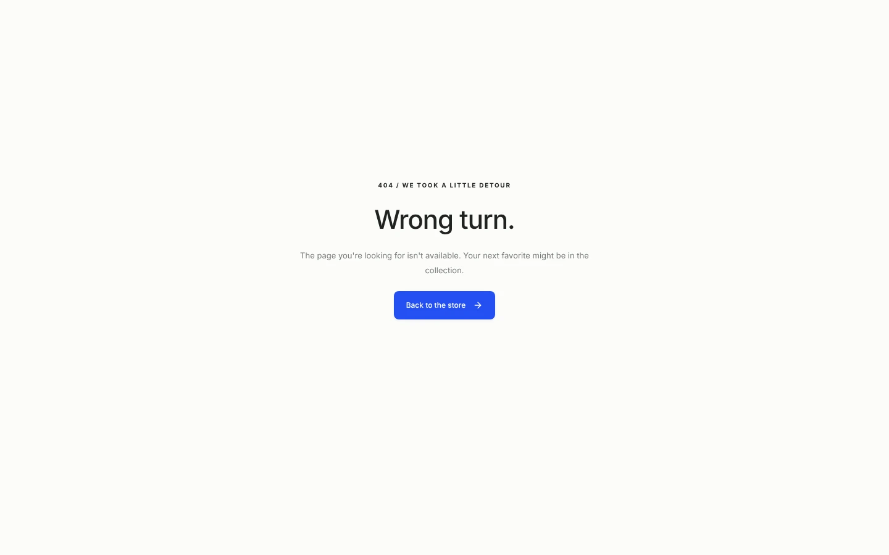</a><br />**Página no encontrada**<br />`/en/this-page-does-not-exist` · Escritorio 1440×900<br />Una URL desconocida bajo un prefijo de idioma responde con un HTTP 404 real y esta página traducida. |  |

## Bolsa y compra

El camino desde la bolsa vacía hasta un pedido guardado. Los pedidos usan el pago manual, así que no se cobra nada.

| | |
| --- | --- |
| <a href="screenshots/en/bag-empty.webp" title="Imagen completa">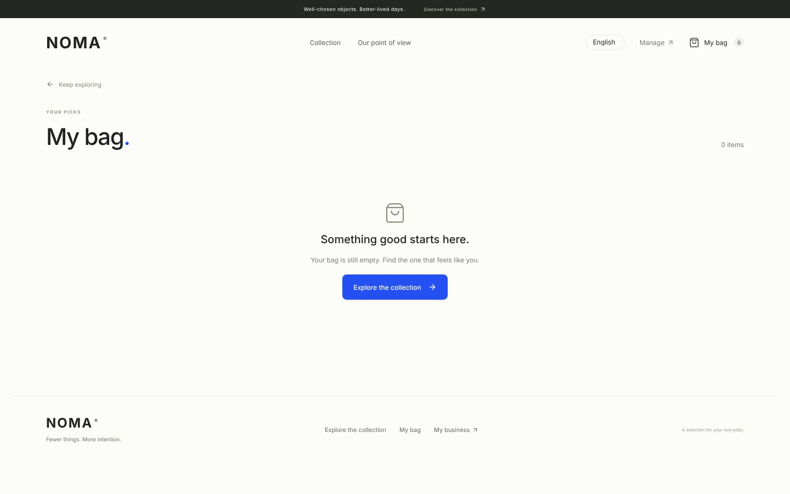</a><br />**Bolsa vacía**<br />`/en/cart` · Escritorio 1440×900<br />Lo que ve un visitante nuevo en la bolsa antes de agregar algo. | <a href="screenshots/en/bag-checkout.webp" title="Imagen completa">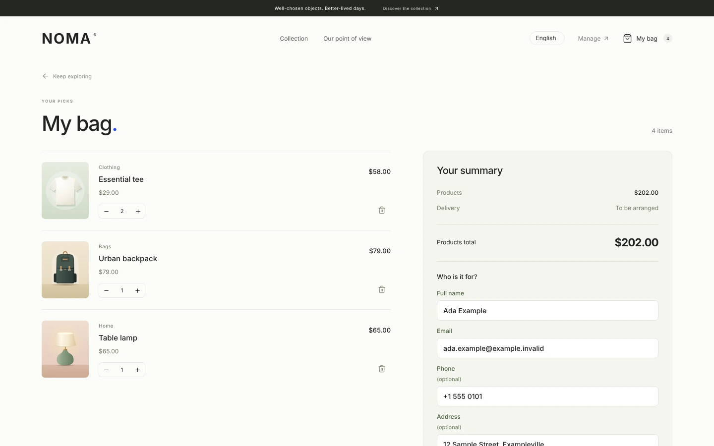</a><br />**Bolsa con productos y formulario de compra**<br />`/en/cart` · Escritorio 1440×900<br />Tres productos (cuatro artículos) en la bolsa y el formulario del cliente completado con un cliente ficticio. El servidor recalcula el total al registrar el pedido. |
| <a href="screenshots/en/order-received.webp" title="Imagen completa">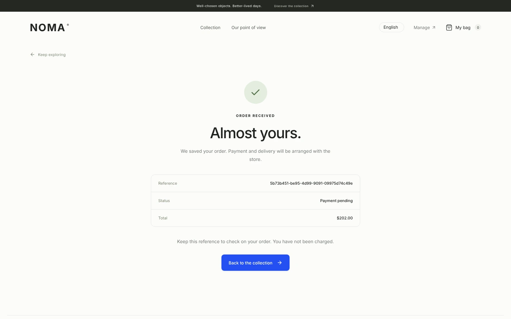</a><br />**Pedido recibido**<br />`/en/cart` · Escritorio 1440×900<br />La confirmación después de que la solicitud real de compra tuvo éxito: referencia, estado de pago pendiente y total. | <a href="screenshots/en/checkout-return.webp" title="Imagen completa">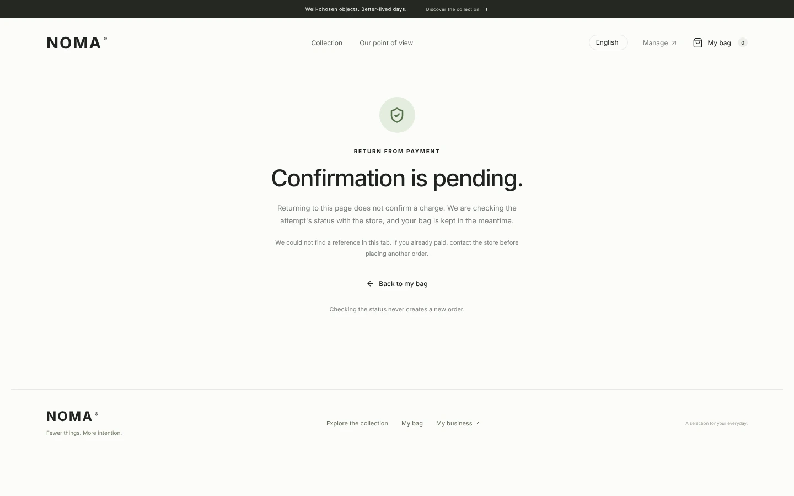</a><br />**Regreso del pago**<br />`/en/checkout/return` · Escritorio 1440×900<br />La página a la que llega el cliente tras un pago alojado, abierta aquí sin intento pendiente en la pestaña. Volver nunca confirma un cobro por sí solo. |

## Administración

El espacio del negocio: resumen, catálogo, inventario, pedidos, la guía de conexión del agente y los ajustes en vivo.

| | |
| --- | --- |
| <a href="screenshots/en/admin-overview.webp" title="Imagen completa">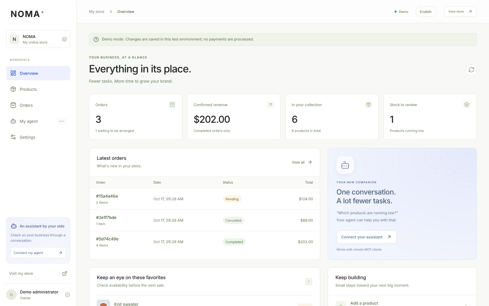</a><br />**Resumen**<br />`/en/admin` · Escritorio 1440×900<br />Métricas, últimos pedidos, productos con pocas existencias y acciones rápidas del negocio de demostración. | <a href="screenshots/en/admin-products.webp" title="Imagen completa">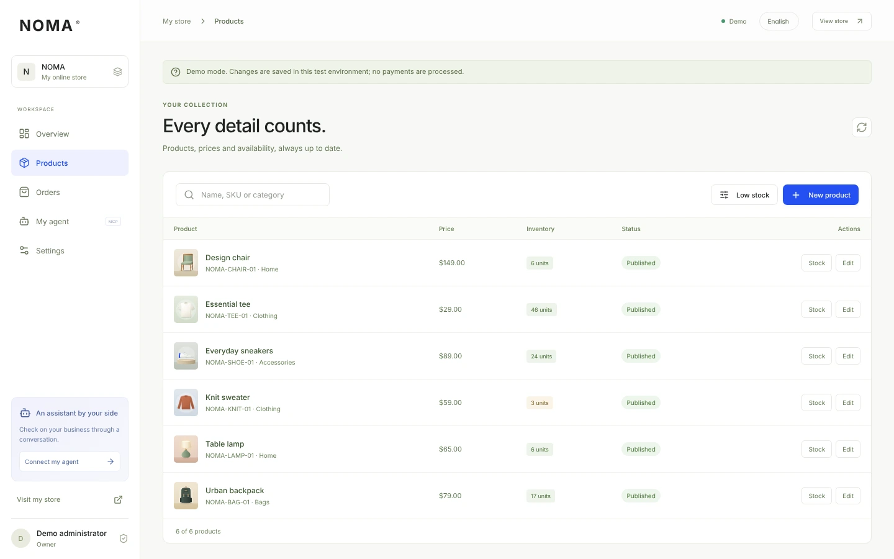</a><br />**Productos**<br />`/en/admin` · Escritorio 1440×900<br />La tabla del catálogo con precio, inventario y estado de publicación, con las acciones de editar y de existencias. |
| <a href="screenshots/en/admin-product-editor.webp" title="Imagen completa">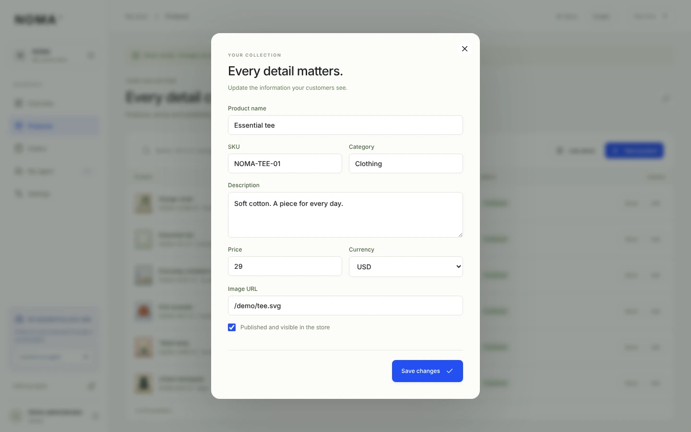</a><br />**Editor de producto**<br />`/en/admin` · Escritorio 1440×900<br />El diálogo de edición de un producto existente. El precio se escribe en unidades mayores y se guarda como unidades menores enteras. | <a href="screenshots/en/admin-stock.webp" title="Imagen completa">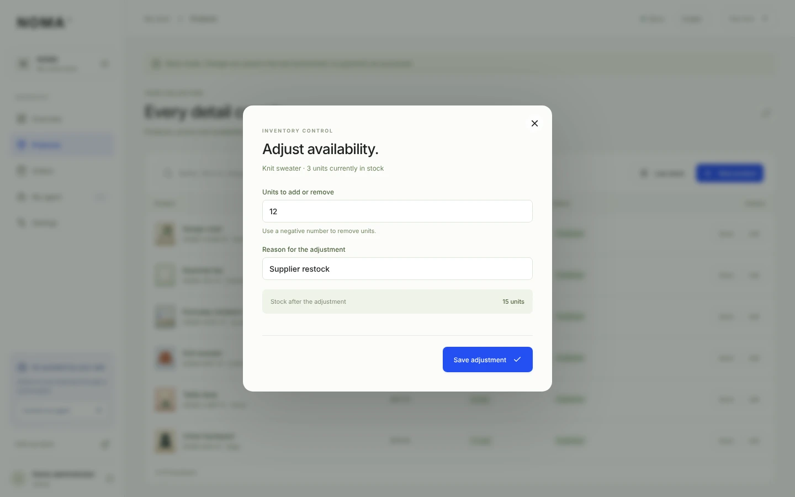</a><br />**Ajuste de existencias**<br />`/en/admin` · Escritorio 1440×900<br />El diálogo de inventario con una reposición escrita. Muestra la cantidad resultante; cada ajuste guardado queda auditado con su motivo. |
| <a href="screenshots/en/admin-orders.webp" title="Imagen completa">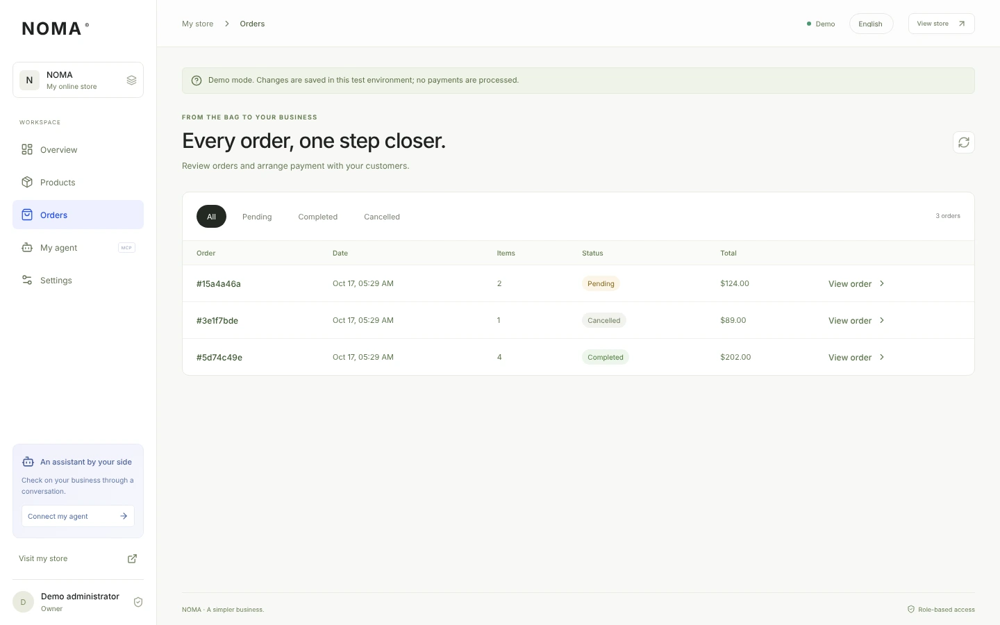</a><br />**Pedidos**<br />`/en/admin` · Escritorio 1440×900<br />Tres pedidos hechos desde la tienda: uno pendiente, uno completado y uno cancelado desde la administración. | <a href="screenshots/en/admin-order-detail.webp" title="Imagen completa">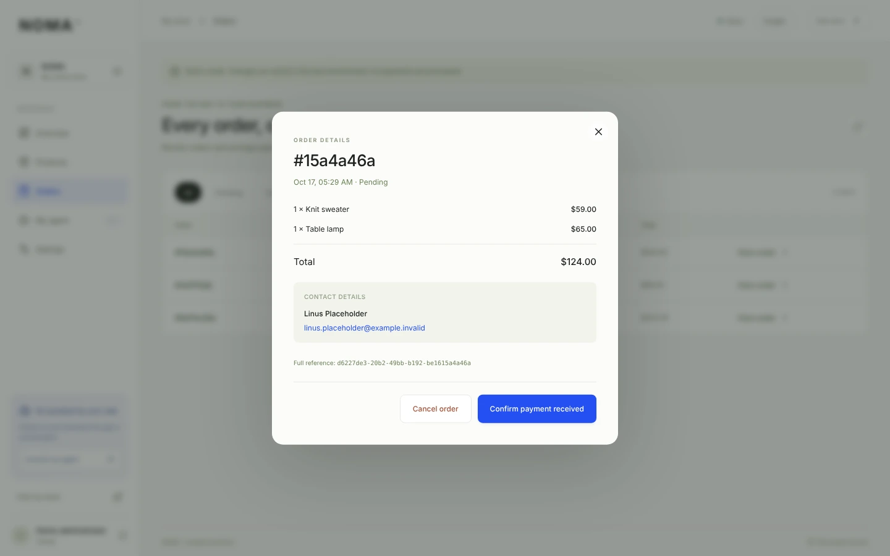</a><br />**Detalle de pedido**<br />`/en/admin` · Escritorio 1440×900<br />Un pedido pendiente con sus líneas, los datos de contacto del cliente y las acciones para confirmar el pago o cancelar. |
| <a href="screenshots/en/admin-agents.webp" title="Imagen completa">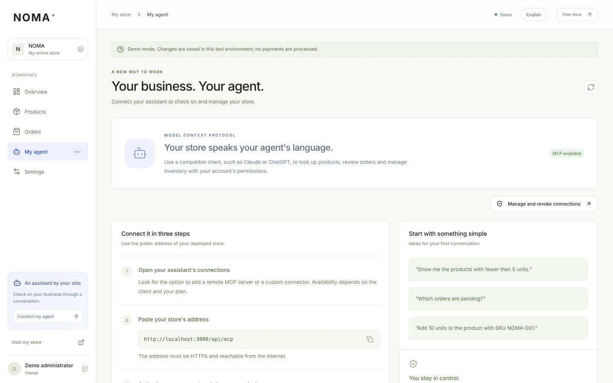</a><br />**Guía de conexión del agente**<br />`/en/admin` · Escritorio 1440×900<br />Tres pasos para agregar la tienda como conexión MCP remota, con la dirección para copiar y mensajes de ejemplo. | <a href="screenshots/en/admin-settings.webp" title="Imagen completa">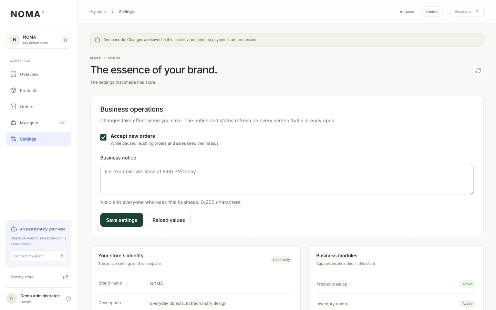</a><br />**Ajustes**<br />`/en/admin` · Escritorio 1440×900<br />La tarjeta de operaciones en vivo (aviso del negocio y pausa o reanudación de pedidos) sobre los ajustes de identidad y módulos, de solo lectura. |
| <a href="screenshots/en/admin-mobile.webp" title="Imagen completa">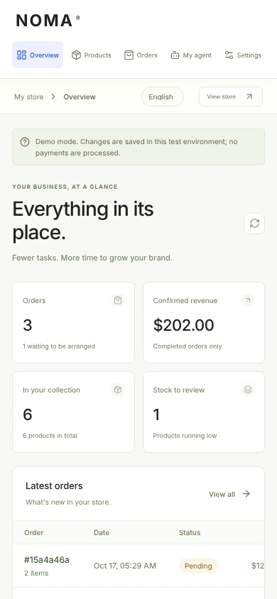</a><br />**Administración en el teléfono**<br />`/en/admin` · Teléfono 390×844<br />El resumen con 390 px de ancho: la barra lateral se convierte en una barra de navegación compacta. |  |

## Cuenta y acceso de agentes

Inicio de sesión, creación del negocio y el consentimiento OAuth que permite a un asistente operar el negocio por MCP.

| | |
| --- | --- |
| <a href="screenshots/en/sign-in.webp" title="Imagen completa">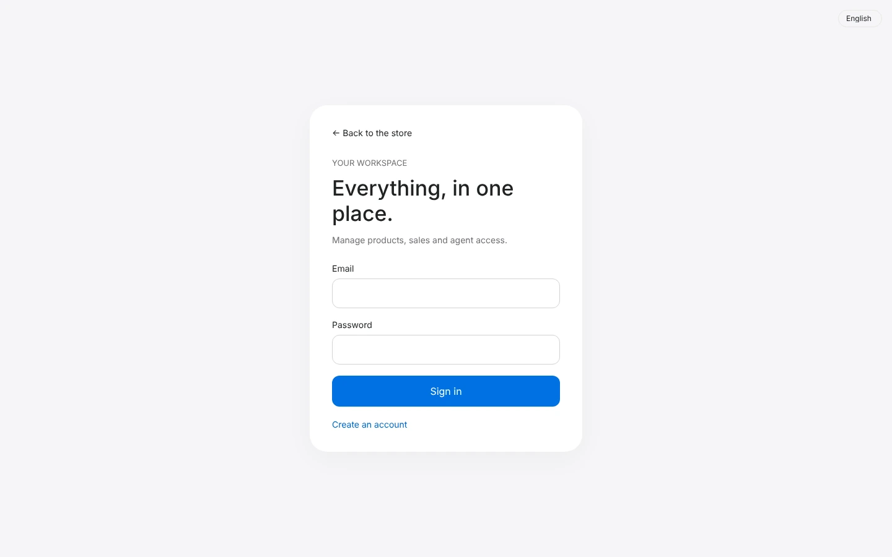</a><br />**Iniciar sesión**<br />`/en/sign-in` · Escritorio 1440×900<br />La página de inicio de sesión. También recibe los parámetros firmados de una autorización OAuth. | <a href="screenshots/en/create-account.webp" title="Imagen completa">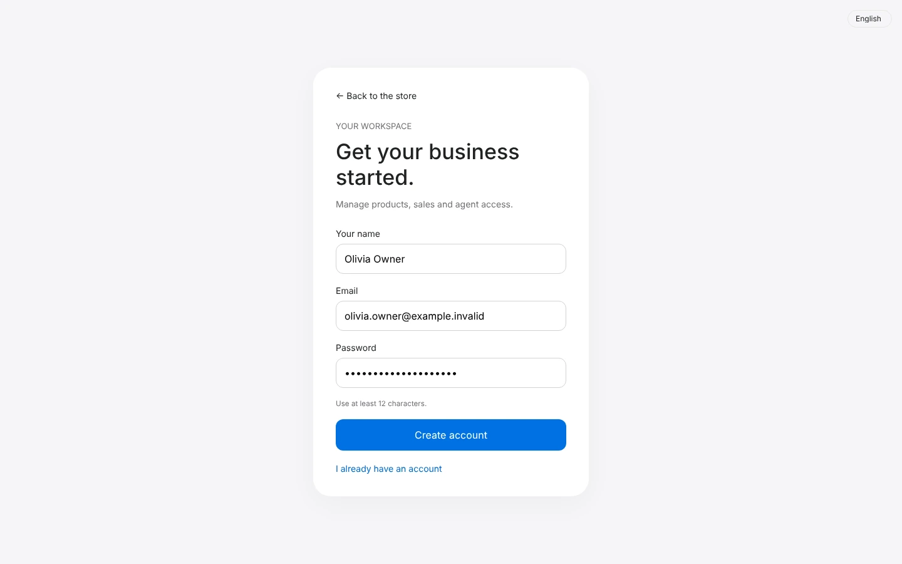</a><br />**Crear cuenta**<br />`/en/sign-in` · Escritorio 1440×900<br />La misma página en modo de creación de cuenta con un propietario ficticio. Las contraseñas necesitan al menos 12 caracteres. |
| <a href="screenshots/en/onboarding.webp" title="Imagen completa">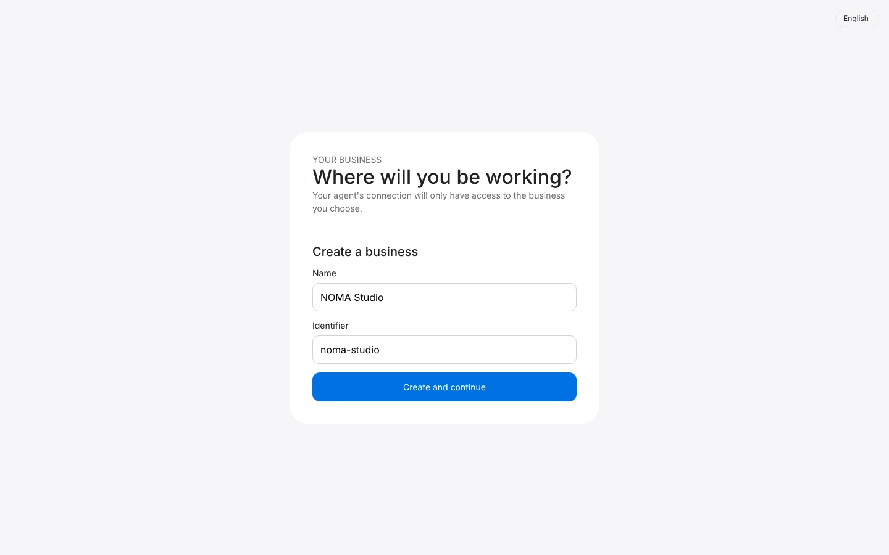</a><br />**Crear un negocio**<br />`/en/onboarding` · Escritorio 1440×900<br />Tras registrarse, el propietario crea el negocio (organización) al que quedará limitada la conexión del agente. | <a href="screenshots/en/consent.webp" title="Imagen completa">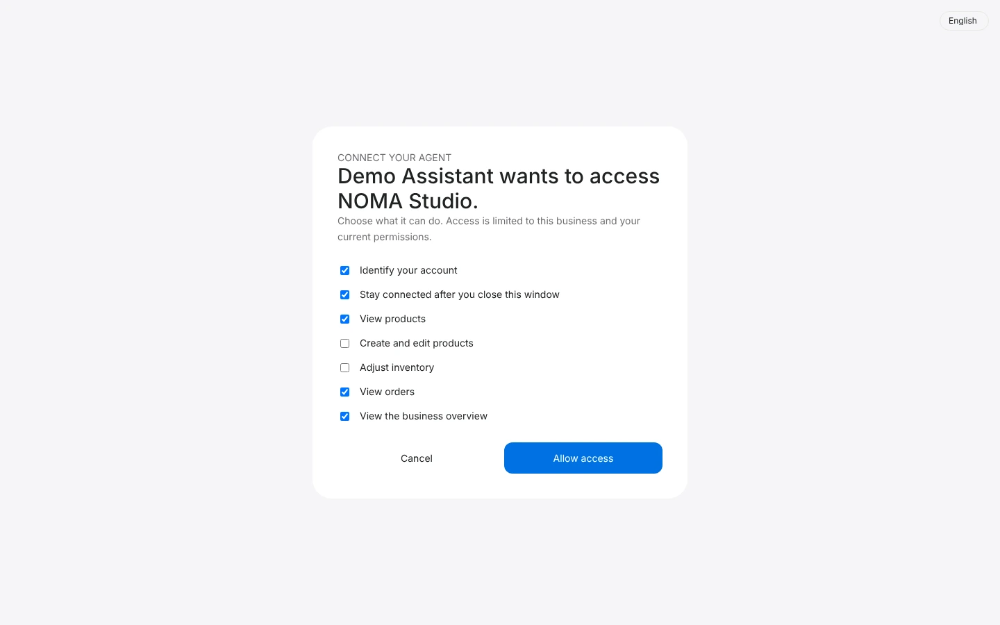</a><br />**Consentimiento OAuth**<br />`/en/consent` · Escritorio 1440×900<br />Un cliente registrado dinámicamente pide acceso con PKCE. La página solo se muestra con parámetros genuinamente firmados; los permisos de escritura empiezan sin marcar. |
| <a href="screenshots/en/connections.webp" title="Imagen completa">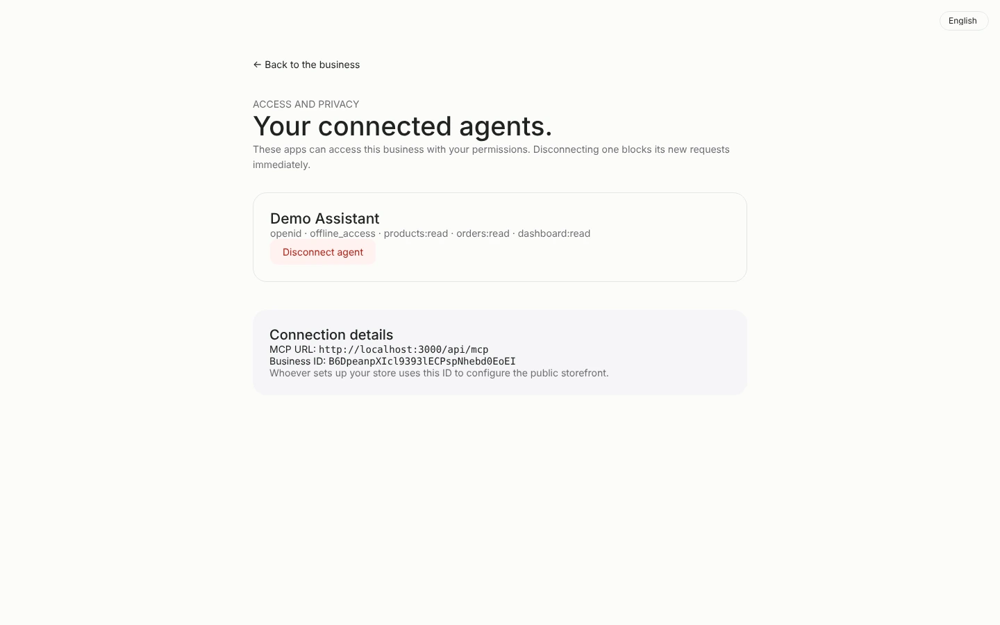</a><br />**Agentes conectados**<br />`/en/onboarding/connections` · Escritorio 1440×900<br />El cliente autorizado en la pantalla anterior, con sus permisos concedidos, un botón para desconectar y la URL de MCP. |  |

## Regenerar

Instale el navegador una vez con `npx playwright install chromium` y ejecute:

```bash
npm run screenshots
```

El comando restablece el `demo.db` local, inicia el servidor de demostración, recorre las 23 pantallas y reconstruye esta página y su equivalente en inglés. `SCREENSHOT_LOCALE=es npm run screenshots` ejecuta el mismo recorrido con la interfaz en español y escribe `docs/screenshots/es/`, que Git ignora.

Cómo se hicieron las capturas, las mediciones del formato de imagen, los atajos declarados y lo que no se muestra están en [screenshots/PROVENANCE.md](screenshots/PROVENANCE.md) (en inglés).
